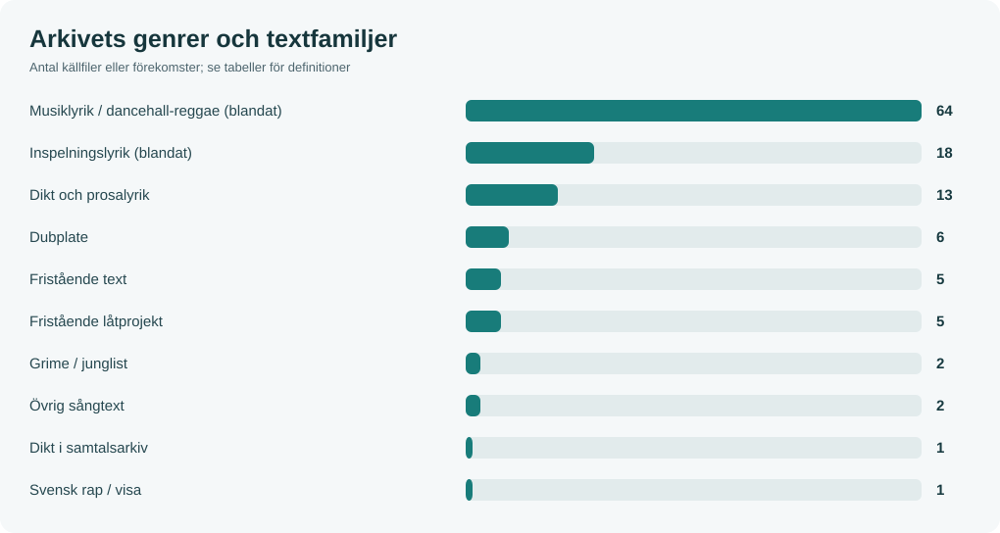
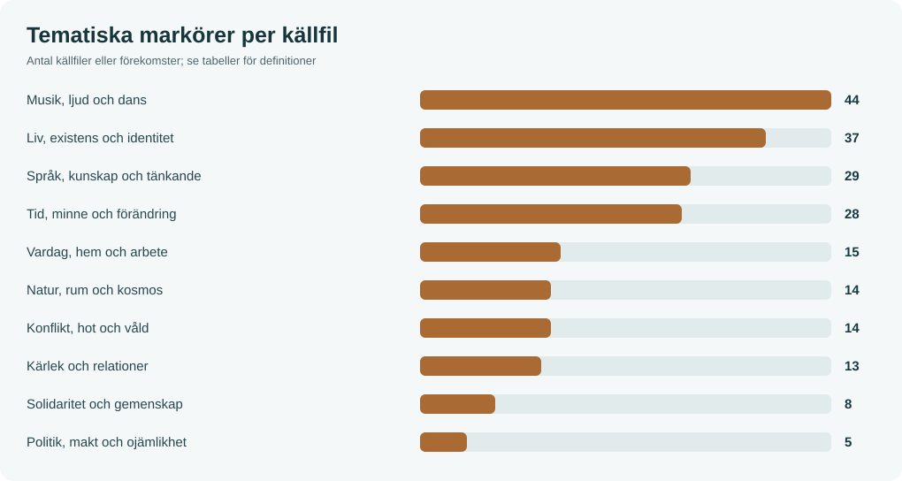
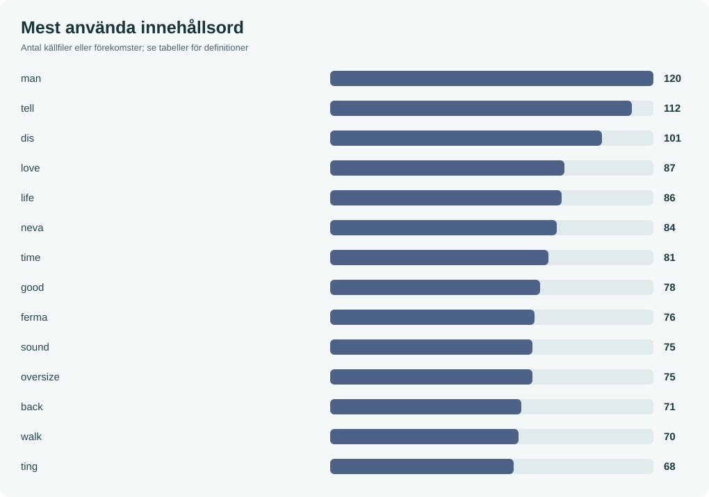

# Texts-n-Lyrics · Linus Fast

Ett källbevarande litterärt arkiv och en **öppen språklig atlas**: poesi, prosalyrik, reggae-/dancehalltexter, rap, grime, dubplates och musikaliska berättelser.

## Arkivet i siffror – unika källtexter

| Unika textkällor | Ordförekomster | Distinkta ordformer | Upprepade rader borttagna (ord) |
| --- | --- | --- | --- |
| 117 | 37,971 | 5,941 | 32,091 |
**Deduplicering:** 120 fysiska original → **117 unika källtexter**; 3 dubbletter/versioner exkluderade. 116 läskopior räknas inte separat. En källtext kan innehålla flera verk, så antalet är inte ett slutgiltigt antal litterära verk.

## Utforska samlingen

| Ingång | Beskrivning |
| --- | --- |
| [Wiki/atlas – startsida](wiki/Home.md) | Förklaringar, navigering och statistisk översikt |
| [Unika texter](wiki/Unika-texter.md) | Kanoniska källtexter och sammanslagna kopior |
| [Verkindex](wiki/Verkindex.md) | Bläddra per titel, form, omfång och fokus |
| [Genre och form](wiki/Genre-och-form.md) | Källfamiljer och provisoriska genreklasser |
| [Teman och motiv](wiki/Teman-och-motiv.md) | Kärlek, samhälle, musik, natur, existens m.m. |
| [Ämnen och fokus](wiki/Amnen-och-fokus.md) | Ämnesklassning separat från textens huvudfokus |
| [Figurer och referenser](wiki/Figurer.md) | Artistpersonae, fiktiva figurer och kulturreferenser |
| [Semantisk ordatlas](wiki/Semantik.md) | Mest använda ord, innehållsord, patois, fraser och kontext |
| [Redaktionell närläsning](wiki/Redaktionell-analys.md) | Exempel på perspektiv, återkommande uttryck och genreblandning |
| [Metod och datakvalitet](wiki/Korpus-och-metod.md) | Källor, definitionsregler, begränsningar |
| [Rådata](analytics/) | CSV-filer, JSON och konkordans |
| [Original](originals/) / [läsbara utgåvor](readable/) | Oförändrade original och separat textextraktion |

## Genrer och former – efter källarkivets familjer

| Form/källfamilj | Källfiler | Andel |
| --- | --- | --- |
| Musiklyrik / dancehall-reggae (blandat) | 64 | 54.7 % |
| Inspelningslyrik (blandat) | 18 | 15.4 % |
| Dikt och prosalyrik | 13 | 11.1 % |
| Dubplate | 6 | 5.1 % |
| Fristående text | 5 | 4.3 % |
| Fristående låtprojekt | 5 | 4.3 % |
| Grime / junglist | 2 | 1.7 % |
| Övrig sångtext | 2 | 1.7 % |
| Dikt i samtalsarkiv | 1 | 0.9 % |
| Svensk rap / visa | 1 | 0.9 % |
## Återkommande teman – lexikala indikatorer

| Tema | Källfiler | Andel | Visuell andel |
| --- | --- | --- | --- |
| Musik, ljud och dans | 43 | 36.8 % | ▰▰▰▰▰▰ |
| Liv, existens och identitet | 37 | 31.6 % | ▰▰▰▰▰ |
| Tid, minne och förändring | 28 | 23.9 % | ▰▰▰▰ |
| Språk, kunskap och tänkande | 28 | 23.9 % | ▰▰▰▰ |
| Vardag, hem och arbete | 15 | 12.8 % | ▰▰ |
| Konflikt, hot och våld | 14 | 12.0 % | ▰▰ |
| Natur, rum och kosmos | 13 | 11.1 % | ▰▰ |
| Kärlek och relationer | 13 | 11.1 % | ▰▰ |
| Solidaritet och gemenskap | 8 | 6.8 % | ▰ |
| Politik, makt och ojämlikhet | 5 | 4.3 % | ▰ |
## Retoriskt fokus – provisorisk indexering

| Fokus | Källfiler |
| --- | --- |
| Ej fastställt | 52 |
| Musik och scen | 35 |
| Kärlek och relation | 13 |
| Språk och reflektion | 12 |
| Samhällskritik | 5 |
## Sakområden – ämnesklassning

| Ämne | Källfiler |
| --- | --- |
| Musik, scen och ljud | 40 |
| Kärlek och partnerskap | 12 |
| Krig och våld | 10 |
| Natur, väder och årstider | 9 |
| Ekonomi, marknad och klass | 9 |
| Resor och geografi | 4 |
| Barn, familj och föräldraskap | 2 |
| Teknik och digitalisering | 2 |
| Rättvisa och välfärd | 1 |
## Vanliga innehållsord

| Ordform | Antal | Källfiler |
| --- | --- | --- |
| man | 119 | 53 |
| tell | 112 | 40 |
| dis | 100 | 52 |
| love | 87 | 34 |
| life | 85 | 47 |
| neva | 84 | 35 |
| time | 81 | 35 |
| good | 77 | 38 |
| sound | 75 | 17 |
| oversize | 75 | 4 |
| ferma | 73 | 41 |
| walk | 69 | 26 |
| ting | 67 | 31 |
| back | 66 | 40 |
| need | 63 | 33 |

## Röst och återkommande figurregister

| Namn | Typ | Filer |
| --- | --- | --- |
| Daddy Ferma | artistpersona | 37 |
| Klara | namngiven person i text | 3 |
| Jah Cure | artistreferens | 2 |
| Santa | kulturfigur | 2 |
| Captain Picard | kulturell referens | 1 |
| Eek-A-Mouse | artistreferens | 1 |
| The Hatter | artistpersona/figur | 1 |
| Captain Kirk | kulturell referens | 1 |
| Peter Pan-ta | fiktiv figur | 1 |
| Icarus | mytologisk figur | 1 |

## Redaktionell och vetenskaplig integritet

- Detta är en **korpusstatistisk indexering**, inte en bevisad psykologisk profil eller litterär kvalitetsbedömning.
- **Genre, tema, ämne och fokus är olika dimensioner**; flera teman kan finnas i en text.
- Råfilerna i originals/ förändras aldrig av statistiken; derivat lagras under readable/, analytics/ och wiki/.
- Native GitHub Wiki är ett separat Git-repository. Denna wiki har versionshanterad källa i mappen wiki/ och kan speglas till GitHubs Wiki-gränssnitt.
- Namn på externa artister, fiktiva figurer och artistpersonae redovisas separat; en namnträff är inte ett belägg för narrativ huvudroll.

[Arkivets källstatus](catalog/INDEX.md) · [62 tidigare identifierade chattverk](catalog/chat-register-2024-2026.md) · [Källmanifest](catalog/SOURCE_MANIFEST.md)

*Statistik genererad 2026-11-12 med tools/analyze_archive.py.*
