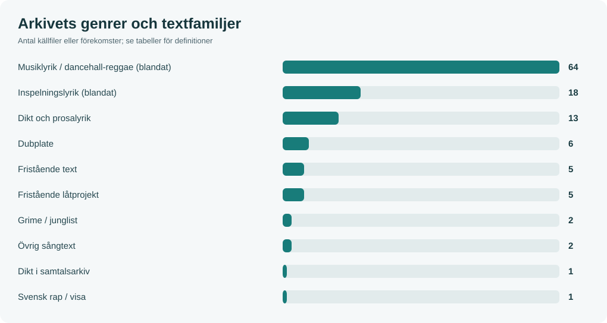
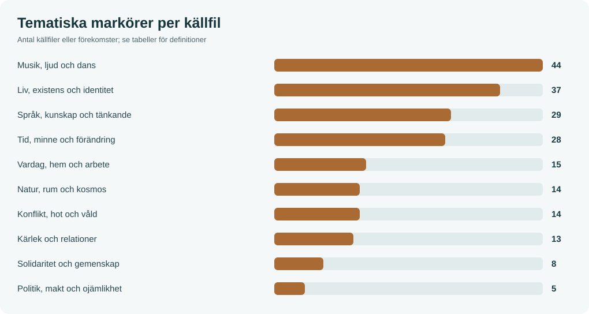

# Texts-n-Lyrics – verk och språklig atlas

[Hem](Home.md) · [Unika texter](Unika-texter.md) · [Verkindex](Verkindex.md) · [Genre och form](Genre-och-form.md) · [Teman](Teman-och-motiv.md) · [Ämnen och fokus](Amnen-och-fokus.md) · [Figurer](Figurer.md) · [Semantik](Semantik.md) · [Redaktionell analys](Redaktionell-analys.md) · [Metod](Korpus-och-metod.md)

## Översikt

| Mått | Verdi |
| --- | --- |
| Unika källtexter | 117 |
| Fysiska originalfiler | 120 |
| Dubbletter eller versioner (ej räknade) | 3 |
| Läskopior (räknas ej separat) | 116 |
| Ordförekomster (inklusive upprepade refränger) | 37,971 |
| Ordförekomster efter upprepade rader tagits bort | 32,091 |
| Distinkta ordformer | 5,941 |
| Sammanslagna textfamiljer | 3 |

## Genre och ursprunglig form

| Form/källfamilj | Filer | Andel |
| --- | --- | --- |
| Musiklyrik / dancehall-reggae (blandat) | 64 | 54.7 % |
| Inspelningslyrik (blandat) | 18 | 15.4 % |
| Dikt och prosalyrik | 13 | 11.1 % |
| Dubplate | 6 | 5.1 % |
| Fristående text | 5 | 4.3 % |
| Fristående låtprojekt | 5 | 4.3 % |
| Grime / junglist | 2 | 1.7 % |
| Övrig sångtext | 2 | 1.7 % |
| Dikt i samtalsarkiv | 1 | 0.9 % |
| Svensk rap / visa | 1 | 0.9 % |

## Tematiska signaler

| Tematisk dimension | Filer | Andel | Fördelning |
| --- | --- | --- | --- |
| Musik, ljud och dans | 43 | 36.8 % | ▰▰▰▰▰▰ |
| Liv, existens och identitet | 37 | 31.6 % | ▰▰▰▰▰ |
| Tid, minne och förändring | 28 | 23.9 % | ▰▰▰▰ |
| Språk, kunskap och tänkande | 28 | 23.9 % | ▰▰▰▰ |
| Vardag, hem och arbete | 15 | 12.8 % | ▰▰ |
| Konflikt, hot och våld | 14 | 12.0 % | ▰▰ |
| Natur, rum och kosmos | 13 | 11.1 % | ▰▰ |
| Kärlek och relationer | 13 | 11.1 % | ▰▰ |
| Solidaritet och gemenskap | 8 | 6.8 % | ▰ |
| Politik, makt och ojämlikhet | 5 | 4.3 % | ▰ |

## Vidare analys

- [Säkrade unika texter och borttagna dubbelräkningar](Unika-texter.md)
- [Läs direkt ur verkindex](Verkindex.md)
- [Ämne respektive retoriskt fokus](Amnen-och-fokus.md)
- [Figurer, karaktärer och artistpersonae](Figurer.md)
- [Ordformer, innehållsord, dialekt, n-gram och konkordans](Semantik.md)
- [Korpus, osäkerhet, urval och metod](Korpus-och-metod.md)

> Kategorierna ovan är **lexikala indikatorer**, inte fastställda litteraturvetenskapliga tolkningar. Ett verk kan matcha flera teman. Dokument/fil är inte detsamma som unikt litterärt verk. 
